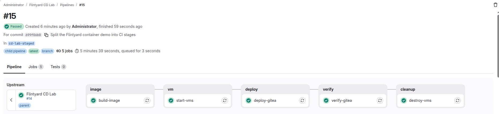

# Flintyard

[简体中文](README.md) · [Installation](docs/install.md) · [User guide](docs/usage.md) · [CLI reference](docs/cli.md)

Flintyard is a local Firecracker CLI for development machines and self-hosted CI. It starts one or more Linux microVMs from an image, gives each node its own writable disk and IPv4 address, and removes the environment when you are done.

## Features

| Feature | Commands |
| --- | --- |
| Host diagnostics | `doctor` checks KVM, binaries, privileges, network tools, and cgroups |
| Image builds | `image build` creates portable `.fyimg` packages from JSON recipes with a prebuilt kernel or pinned kernel source and configuration |
| Image import and validation | `image import` imports a package or assembles one from local files. `image inspect` shows its manifest and checksums. `image validate` boots a temporary guest and runs a probe |
| Multi-node environments | `up` creates a group of nodes with separate writable disks and IPv4 addresses from a single JSON file |
| Access and networking | `status --probe` repeats TCP or SSH banner checks. Environments can opt into NAT and explicit TCP/UDP port forwards |
| State and logs | `status`, `list`, and `logs` expose observed state and serial or Firecracker startup logs. Scripts can read `-o json` results and `--events FILE` |
| Stop and cleanup | `stop` retains writable disks for another `up`. `down` discards them. `gc` previews and recovers owned stale resources |

## Quick start

1. Build the CLI on a Linux KVM host, install Firecracker and jailer, and run `doctor`. [Installation](docs/install.md)
2. Use a `.fyimg` for the host architecture or build a Debian image. [Build a Debian image](fixtures/README.en.md#debian-stock-kernel-offline-image)
3. Import the image, start a node, log in over SSH, and remove the environment when finished. [Single-node quickstart](docs/usage.md#single-node-quickstart)

## Run a container application in CI

The GitLab example uses Flintyard to provision disposable microVMs. CI deploys Gitea inside the guests on Docker and K3s. [Run locally or on a GitLab Runner](docs/container-workload.md)

## Documentation

- [Host and image compatibility](docs/compatibility.md)
- [Boot, log in, stop, resume, and destroy](docs/usage.md)
- [Image import, build recipes, kernels, and validation](docs/images.md)
- [Private networks, NAT, port forwarding, and troubleshooting](docs/networking.md)
- [CLI flags, JSON results, and exit codes](docs/cli.md)
- [Configuration examples](examples/README.en.md) and [JSON schemas](schemas/)
- [Development, testing, and contributions](CONTRIBUTING.md)

## License

Flintyard is licensed under the [MIT License](LICENSE). See [third-party notices](THIRD-PARTY-NOTICES.md) for separately licensed materials.
