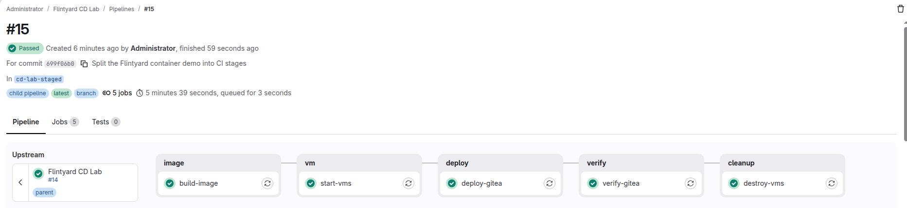

# Flintyard

[English](README.en.md) · [全生命周期教程](docs/usage.zh-CN.md) · [CLI 参考](docs/cli.zh-CN.md)

Flintyard 是面向开发机和自托管 CI 的本地 Firecracker 命令行工具。它从 Linux 镜像启动一个或多个微虚机，为每个节点分配独立的可写盘和 IPv4 地址，并在任务结束后清理环境。

## 功能

| 功能 | 用法 |
| --- | --- |
| 宿主诊断 | `doctor` 检查 KVM、运行二进制、权限、网络工具和 cgroup |
| 镜像构建 | `image build` 根据 JSON 配方制作可搬运的 `.fyimg`，使用已有内核或从固定源码和配置编译 |
| 镜像导入与验证 | `image import` 导入包或从本地文件组包。`image inspect` 查看清单和摘要。`image validate` 临时启动并执行探针 |
| 多节点环境 | `up` 根据同一份 JSON 启动多个节点，为每个节点创建独立可写盘和 IPv4 地址 |
| 访问和网络 | `status --probe` 复查 TCP 或 SSH banner。可为环境开启 NAT 和显式 TCP/UDP 端口映射 |
| 状态与日志 | `status`、`list` 和 `logs` 查看当前状态、串口和 Firecracker 启动日志。`-o json` 与 `--events FILE` 便于脚本读取 |
| 停机与清理 | `stop` 保留可写盘供再次 `up`。`down` 销毁可写盘。`gc` 预览并回收已确认归属的残留资源 |

## 快速开始

按一页教程完成 **构建二进制 → 安装运行工具 → 制作或导入镜像 → 配置虚机 → 启动和 SSH → 停机恢复与销毁**。命令从同一个仓库根目录运行，换终端时只需回到该目录。 [从源码到运行第一台微虚机](docs/usage.zh-CN.md#单节点快速开始)

## 在 CI 中运行容器应用

GitLab 示例使用 Flintyard 创建临时微虚机，由 CI 在客户机内通过 Docker 和 K3s 分别部署 Gitea。 [在本机和 GitLab Runner 上运行](docs/container-workload.zh-CN.md)

## 文档

- [宿主要求、构建与诊断](docs/install.zh-CN.md) · [兼容性](docs/compatibility.zh-CN.md)
- [虚机资源、多节点与访问配置](docs/usage.zh-CN.md#设置虚机资源和网络)
- [镜像导入、自有文件组包、配方和启动验证](docs/images.zh-CN.md) · [发行版构建配方](fixtures/README.md)
- [私网、NAT、端口映射和排错](docs/networking.zh-CN.md)
- [CLI 参数、JSON 和退出码](docs/cli.zh-CN.md)
- [配置样例](examples/README.md) 和 [JSON Schema](schemas/)
- [开发、测试和贡献](CONTRIBUTING.zh-CN.md)

## 许可证

Flintyard 采用 [MIT 许可证](LICENSE)。第三方材料的来源和许可见 [第三方声明](THIRD-PARTY-NOTICES.md)。
