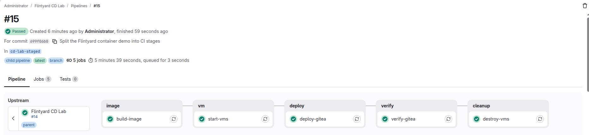
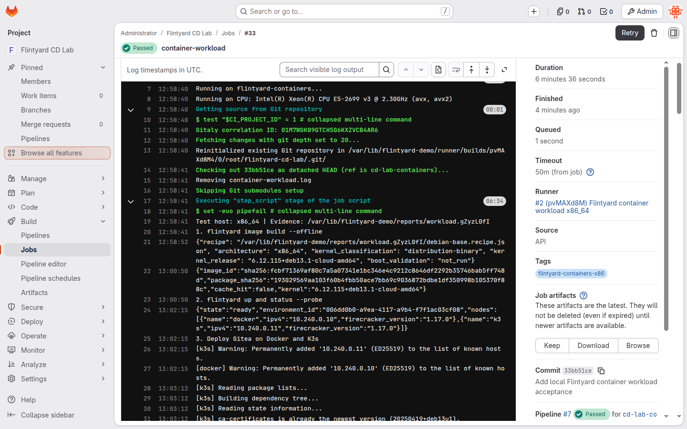
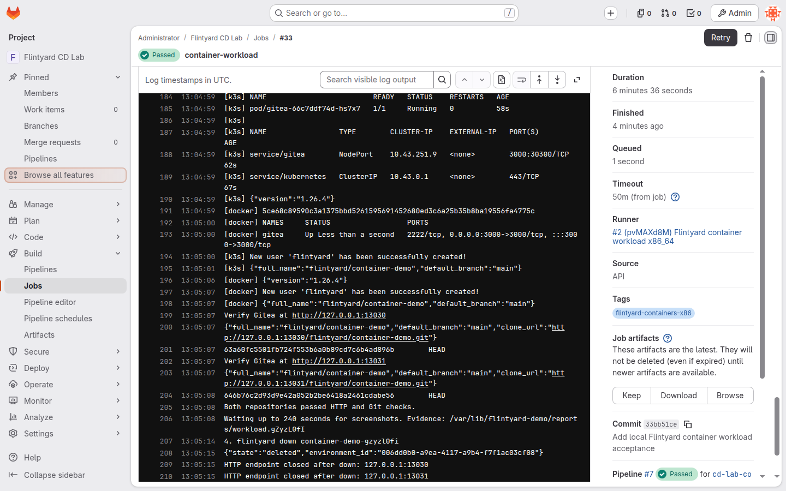

# Run a container workload in disposable microVMs

[简体中文](container-workload.zh-CN.md)

Start two Firecracker microVMs from the same Debian 13 image and deploy Gitea on Docker and K3s. Run the example locally or on a self-hosted GitLab Runner.

## Run the walkthrough

Complete the binary installation and Debian download and extraction in the main walkthrough. This example needs the three binaries under `/opt/flintyard/bin/` and the files in `.local/quickstart/debian-inputs/`. The script builds its own `.fyimg`. Run from the repository root. Install `git` and enable IPv4 forwarding under your host policy. At the prompt, enter an IPv4 DNS server the guests can reach. Allow guest access to Debian package repositories, GitHub downloads, and Docker Hub. Set aside at least 3,328 MiB of available memory for the two guests and space for the image and disks. [Binary installation](usage.md#1-prepare-the-host-and-build-flintyard) · [Prepare Debian inputs](../fixtures/README.en.md#debian-stock-kernel-offline-image) · [Networking](networking.md)

```sh
(
  set -eu
  printf 'Guest-reachable IPv4 DNS: '
  IFS= read -r guest_dns
  test -n "$guest_dns"
  test -f .local/quickstart/debian-inputs/provenance.json
  report_dir=$(sudo mktemp -d /var/lib/flintyard-workload.XXXXXXXX)
  sudo bash tests/container-workload.sh /opt/flintyard/bin/flintyard \
    /opt/flintyard/bin/firecracker /opt/flintyard/bin/jailer \
    .local/quickstart/debian-inputs "$report_dir" "$guest_dns"
)
```

The script prints the report directory. If `/var/lib` is too small, edit the `mktemp` path to use an existing root-managed directory on a larger filesystem. The default host-local ports are 13030 for Docker and 13031 for K3s. For different ports, pass `FY_DEMO_DOCKER_PORT` and `FY_DEMO_K3S_PORT` explicitly after `sudo`, for example `sudo FY_DEMO_DOCKER_PORT=13130 FY_DEMO_K3S_PORT=13131 bash …`. Use `sudo FY_DEMO_HOLD_SECONDS=120 bash …` to keep a short browsing window open after verification. Visit `/flintyard/container-demo` at each forwarded port during that window.

The example connects to each guest over SSH and uses the disposable `devops` account to install the container platform. [Gitea container configuration](https://docs.gitea.com/installation/install-with-docker/)

## Use a self-hosted CI runner

The [parent pipeline](../ci/gitlab-demo.yml) runs on a protected ref when started from the GitLab UI or API. Its resource group serializes demo runs within the project for the duration of the [child pipeline](../ci/gitlab-demo-jobs.yml). Each stage publishes its own `workload-stage.log`. [GitLab resource groups](https://docs.gitlab.com/ci/resource_groups/)

| CI job | Action |
| --- | --- |
| `build-image` | Build and import the locked Debian image with Flintyard. |
| `start-vms` | Boot the two guests from the cached image and verify SSH banner access. |
| `deploy-gitea` | Install Docker and K3s in the corresponding guests, then deploy Gitea. |
| `verify-gitea` | Check both Gitea API responses and Git HEAD refs through the host forwards. |
| `destroy-vms` | Run Flintyard cleanup and check both ports have closed after successful verification. Run even when an earlier job fails. |



Use GitLab 18.2 or newer for `strategy: mirror`. Set the project's CI configuration file to `ci/gitlab-demo.yml` and assign one project-locked, protected Shell Runner tagged `flintyard-workload` on the KVM host. All five jobs use that same machine. Use a Runner dedicated to trusted project code. [GitLab pipeline settings](https://docs.gitlab.com/ci/pipelines/settings/) · [Downstream pipelines](https://docs.gitlab.com/ci/pipelines/downstream_pipelines/)

On the Runner host, prepare the binaries and Debian inputs from the main walkthrough and run the following commands from the repository root. Enter an IPv4 DNS resolver reachable by guests on that Runner.

```sh
(
  set -eu
  printf 'Guest-reachable IPv4 DNS: '
  IFS= read -r guest_dns
  test -n "$guest_dns"
  test -f .local/quickstart/debian-inputs/provenance.json
  install_dir=/opt/flintyard-demo
  data_dir=/var/lib/flintyard-demo
  sudo install -d -m 0755 "$install_dir/bin" "$install_dir/tests" "$install_dir/fixtures"
  sudo install -d -m 0700 "$data_dir" "$data_dir/inputs"
  sudo install -m 0755 /opt/flintyard/bin/flintyard /opt/flintyard/bin/firecracker \
    /opt/flintyard/bin/jailer "$install_dir/bin/"
  sudo install -m 0755 ci/gitlab-demo-run-stage.sh "$install_dir/run-stage"
  sudo install -m 0644 tests/container-workload.sh tests/container-workload-guest.sh "$install_dir/tests/"
  sudo install -m 0644 fixtures/render-debian-cloud.py fixtures/prepare.py fixtures/render.py \
    fixtures/debian-cloud.lock.json fixtures/lock.json "$install_dir/fixtures/"
  sudo cp -R -- .local/quickstart/debian-inputs/. "$data_dir/inputs/"
  printf '%s\n' "$guest_dns" | sudo tee "$install_dir/dns-ipv4" >/dev/null
)
```

Use `visudo` to grant the Runner account passwordless access to the installed `/opt/flintyard-demo/run-stage` command. The following entry uses the `gitlab-runner` account.

```sudoers
gitlab-runner ALL=(root) NOPASSWD: /opt/flintyard-demo/run-stage
```

Download each job's `workload-stage.log` from GitLab. On the runner, inspect the image, state, and diagnostics in the root-owned `/var/lib/flintyard-demo/ci-runs/workload.<child-pipeline-id>` directory. The script removes the temporary SSH key during cleanup. Start a fresh pipeline after a failed build or deployment.

If the pipeline is canceled between jobs or the runner goes offline, you can clean up on the runner host after the pipeline stops. At the prompt, enter the numeric ID in the child pipeline URL (`/-/pipelines/<id>`). If Flintyard reports incomplete cleanup, inspect the report directory and follow [resource recovery](usage.md#recover-stale-resources).

```sh
(
  set -eu
  printf 'Child pipeline ID: '
  IFS= read -r pipeline_id
  sudo /opt/flintyard-demo/run-stage cleanup "$pipeline_id"
)
```

## Check the results

### Image and VM readiness

Check `build.json` for the image ID, package digest, and kernel version. In `status.json`, both guests should be `ready`, with distinct IPv4 addresses and a loopback port forward for each web endpoint.



### Gitea deployment

Docker runs Gitea in a container. K3s exposes a Gitea Deployment through a NodePort Service. For each forwarded port, check that `http-<port>.json` identifies the `flintyard/container-demo` repository and that `git-<port>.log` contains the commit returned by `git ls-remote … HEAD`.

| Gitea on Docker | Gitea on K3s |
| --- | --- |
|  |  |

### Cleanup

Confirm that `down.json` reports `deleted` with an empty `cleanup_errors` list. Both forwarded web endpoints should stop responding. The built image and diagnostics remain in the report directory.


