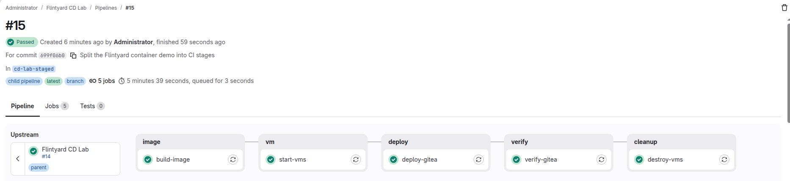
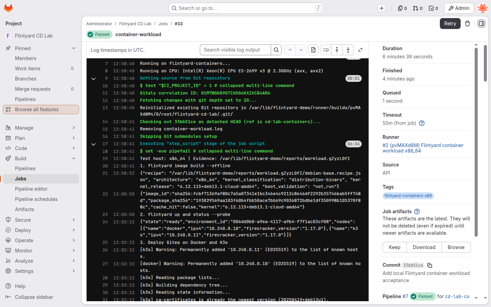
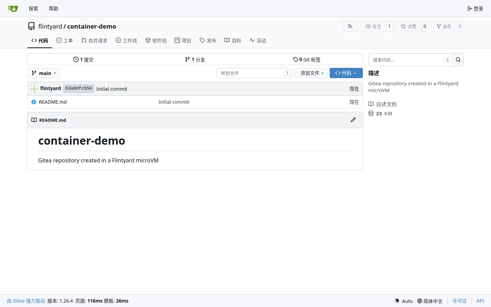
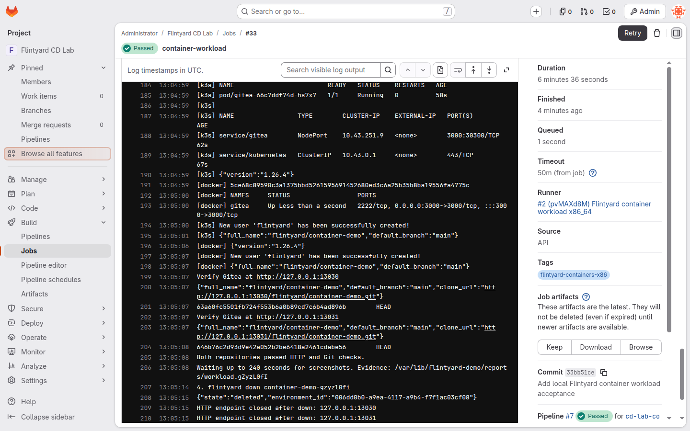

# 在临时微虚机中运行容器业务

[English](container-workload.md)

从一份 Debian 13 镜像启动两台 Firecracker 微虚机，在 Docker 和 K3s 中分别部署 Gitea。示例可在本机运行，也可交给自托管 GitLab Runner。

## 在本机运行

完成安装后，按 Debian 指南准备 `DEBIAN_INPUTS`。宿主需要 `git`，并应按网络策略启用 IPv4 转发。将 `GUEST_DNS` 设为客户机可访问的 IPv4 DNS 服务器，允许客户机访问 Debian 软件包仓库、GitHub 下载及 Docker Hub。为两台虚机预留至少 3,328 MiB 可用内存，并为镜像和磁盘预留空间。 [安装](install.zh-CN.md) · [准备 Debian 输入](../fixtures/README.md#debian-原版内核离线镜像) · [网络](networking.zh-CN.md)

```sh
STATE_PARENT="${STATE_PARENT:-/var/lib}"
REPORT_DIRECTORY="$(sudo mktemp -d "$STATE_PARENT/flintyard-workload.XXXXXXXX")"
: "${GUEST_DNS:?set a DNS server reachable from the guests}" "${DEBIAN_INPUTS:?prepare Debian inputs}"
sudo bash tests/container-workload.sh \
  "$FY" "$FIRECRACKER" "$JAILER" "$DEBIAN_INPUTS" "$REPORT_DIRECTORY" "$GUEST_DNS"
```

脚本会输出报告目录。若 `/var/lib` 空间不足，将 `STATE_PARENT` 设为容量足够且由 root 管理的已有目录。Docker 和 K3s 的宿主端口分别为 13030 和 13031。可通过 `sudo` 显式传入 `FY_DEMO_DOCKER_PORT` 和 `FY_DEMO_K3S_PORT` 更换端口。通过 `sudo` 传入 `FY_DEMO_HOLD_SECONDS=120` 可在验证成功后保留一段访问时间，此时可从两个映射端口访问 `/flintyard/container-demo`。

CI 通过 SSH 连接客户机，并使用镜像中配置的临时 `devops` 用户安装容器平台。 [Gitea 容器配置](https://docs.gitea.com/installation/install-with-docker/)

## 在自托管 GitLab Runner 中运行

从 GitLab 界面或 API 在受保护分支启动 [父流水线](../ci/gitlab-demo.yml)。父流水线使用资源组，在整个子流水线运行期间串行调度本项目的演示任务，各作业分别归档 `workload-stage.log`。 [子流水线定义](../ci/gitlab-demo-jobs.yml) · [GitLab 资源组](https://docs.gitlab.com/ci/resource_groups/)

| CI 作业 | 执行内容 |
| --- | --- |
| `build-image` | 通过 Flintyard 构建并导入锁定的 Debian 镜像。 |
| `start-vms` | 使用缓存镜像启动两台客户机，检查 SSH banner。 |
| `deploy-gitea` | 在对应客户机中安装 Docker 和 K3s，并部署 Gitea。 |
| `verify-gitea` | 通过宿主映射检查两个 Gitea API 和 Git HEAD。 |
| `destroy-vms` | 执行 Flintyard 清理。如果已完成业务验证，同时检查两个端口已关闭。前序作业失败时仍执行此作业。 |



使用支持 `strategy: mirror` 的 GitLab 18.2 或更新版本。将项目的 CI 配置文件设为 `ci/gitlab-demo.yml`，在 KVM 宿主上注册一台专用于项目可信代码的受保护 Shell Runner，标签设为 `flintyard-workload`。五个作业使用同一台机器。 [GitLab 流水线设置](https://docs.gitlab.com/ci/pipelines/settings/) · [下游流水线](https://docs.gitlab.com/ci/pipelines/downstream_pipelines/)

在 Runner 宿主上安装已审查的脚本、运行二进制及准备好的输入。按上文设置 `GUEST_DNS`。

```sh
DEMO_INSTALL=/opt/flintyard-demo
DEMO_DATA=/var/lib/flintyard-demo
sudo install -d -m 0755 "$DEMO_INSTALL/bin" "$DEMO_INSTALL/tests" "$DEMO_INSTALL/fixtures"
sudo install -d -m 0700 "$DEMO_DATA" "$DEMO_DATA/inputs"
sudo install -m 0755 "$FY" "$DEMO_INSTALL/bin/flintyard"
sudo install -m 0755 "$FIRECRACKER" "$DEMO_INSTALL/bin/firecracker"
sudo install -m 0755 "$JAILER" "$DEMO_INSTALL/bin/jailer"
sudo install -m 0755 ci/gitlab-demo-run-stage.sh "$DEMO_INSTALL/run-stage"
sudo install -m 0644 tests/container-workload.sh tests/container-workload-guest.sh "$DEMO_INSTALL/tests/"
sudo install -m 0644 fixtures/render-debian-cloud.py fixtures/prepare.py fixtures/render.py \
  fixtures/debian-cloud.lock.json fixtures/lock.json "$DEMO_INSTALL/fixtures/"
sudo cp -R -- "$DEBIAN_INPUTS"/. "$DEMO_DATA/inputs/"
printf '%s\n' "$GUEST_DNS" | sudo tee "$DEMO_INSTALL/dns-ipv4" >/dev/null
```

用 `visudo` 授权 Runner 账号免密执行已安装的 `/opt/flintyard-demo/run-stage`。以 `gitlab-runner` 账号为例。

```sudoers
gitlab-runner ALL=(root) NOPASSWD: /opt/flintyard-demo/run-stage
```

各作业的 `workload-stage.log` 可从 GitLab 下载。镜像、状态和诊断文件位于 Runner 上由 root 管理的 `/var/lib/flintyard-demo/ci-runs/workload.<child-pipeline-id>`。脚本在清理时删除临时 SSH 密钥。构建或部署失败后，可启动一条新的流水线。

如果流水线在两个作业之间被取消，或 Runner 离线，可在流水线停止后进行清理。将 `CHILD_PIPELINE_ID` 设为子流水线 URL（`/-/pipelines/<id>`）中的数字 ID，再在 Runner 宿主上运行以下命令。如果 Flintyard 报告清理不完整，检查报告目录，按 [资源回收](usage.zh-CN.md#回收残留资源) 处理。

```sh
sudo /opt/flintyard-demo/run-stage cleanup "$CHILD_PIPELINE_ID"
```

## 核对运行结果

### 镜像与虚机状态

在 `build.json` 中核对镜像 ID、包摘要和内核版本。`status.json` 应显示两台客户机均为 `ready`，各有独立的 IPv4 地址和映射到宿主回环地址的 Web 端口。



### Gitea 部署

Docker 在容器中运行 Gitea，K3s 通过 NodePort Service 暴露 Gitea Deployment。对每个映射端口，确认 `http-<port>.json` 指向 `flintyard/container-demo` 仓库，且 `git-<port>.log` 包含 `git ls-remote … HEAD` 返回的提交。

| Docker 上的 Gitea | K3s 上的 Gitea |
| --- | --- |
|  |  |

### 清理

确认 `down.json` 的状态为 `deleted`，且 `cleanup_errors` 为空。两个映射的 Web 入口应停止响应。构建好的镜像和诊断文件保留在报告目录中。


